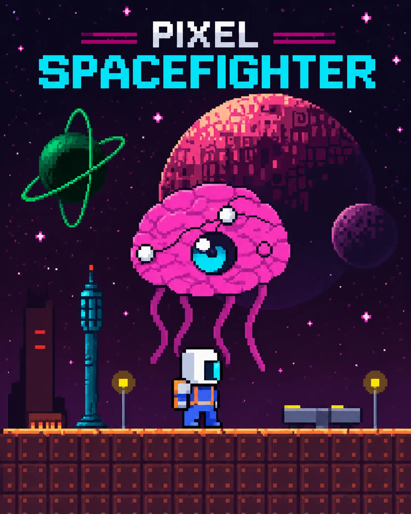

# Pixel Spacefighter

Crea tu piloto en pixel art y pelea en 3 sectores espaciales.

## Jugar

- **Juego:** https://algorithmicslab-stack.github.io/pixel-spacefighter/juego.html
- **Creador de piloto:** https://algorithmicslab-stack.github.io/pixel-spacefighter/
- **Foto a pixel art:** https://algorithmicslab-stack.github.io/pixel-spacefighter/foto.html

También hay una [versión en Python + Pygame](https://github.com/algorithmicslab-stack/pixel-spacefighter-pygame).

## Controles

| Acción | Teclas |
|---|---|
| Moverse | ← → / A D |
| Saltar | ↑ / W / Espacio / Z |
| Disparar | J / X / K |
| Empezar | Enter |
| Pausa | P / Esc |
| Silenciar | M |

En iPad y celular hay controles táctiles en pantalla.
